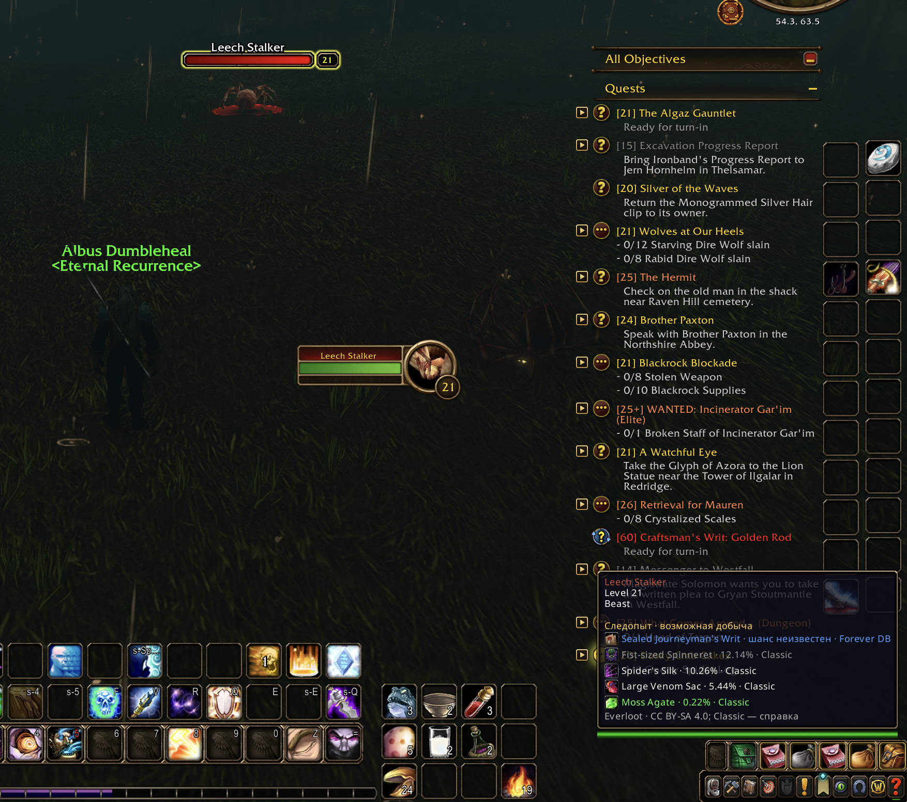
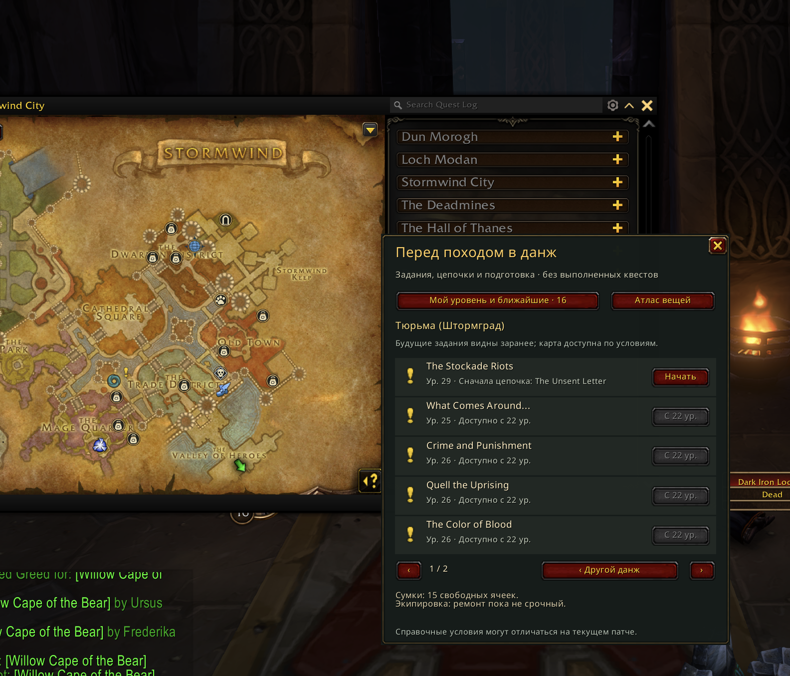
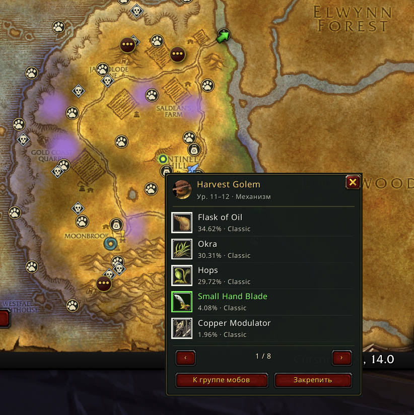

# MobAtlas · Следопыт

**Find gear, see what drops, and plan where to go next in WoW Forever.**

Look up an item, check which creatures drop it or which vendors sell it, and mark known locations on your map. Heading into a dungeon? Check the quest list before you leave.

**Beta · 0.6.4** — still growing, with bugs to fix and gaps in the database. Your feedback helps.

[**Download**](https://github.com/Simplepres/MobAtlas/releases/latest) · [Русский](#на-русском) · [Screenshots](#screenshots--скриншоты) · [Report a bug](https://github.com/Simplepres/MobAtlas/issues)

## What you can do

- Search items by name or ID, then find their known sources on the map.
- Hover over a creature to see its loot. Filter by rarity, class, level or profession materials.
- Browse groups of creatures and vendors, and pin the source you want to track — also during combat on an open map.
- Check dungeon quests and the steps needed to pick them up, including The Hall of Thanes.

The database is included. You don't need Questie, an account or an API key. Personal loot finds and merchant visits stay on your computer.

## Install and play

1. Download **MobAtlas-0.6.4.zip** from [Releases](https://github.com/Simplepres/MobAtlas/releases/latest).
2. Put the **MobAtlas** folder in your Forever client's `Interface/AddOns/` folder.
3. Restart WoW and enable the addon. The file should be at `Interface/AddOns/MobAtlas/MobAtlas.toc`.

Click the book by the minimap or type **`/mobatlas`**. Right-click the book for tracking options. **`/mobatlas prep`** opens dungeon preparation; **`/mobatlas settings`** opens settings.

The interface follows your game language: Russian or English, with English for other locales. Change it anytime with **Auto / RU / EN** at the top of the atlas. Item names and native tooltips come from WoW.

## Screenshots / Скриншоты

Taken in-game on November 19, 2026. The surrounding interface includes other addons.

### Loot on hover · Добыча при наведении

See known drops without opening the atlas. / Наведи на моба — известная добыча появится в подсказке.

### Find an item · Поиск вещей

Narrow the list by level and category, then open a source on the map. A grey Map button means coordinates are missing. / Выбери вещи под свой уровень и посмотри, где их достать. Серая кнопка «Карта» означает, что координат пока нет.

### Before a dungeon · Перед данжем

Check known quests, prerequisite steps, bag space and repairs. / Посмотри задания и цепочки перед походом, проверь сумки и ремонт.

### Choose a source · Выбор на карте

Inspect loot, hover over an item for its stats, and pin the creature you want to find. / Открой добычу моба, наведи на вещь для просмотра характеристик и закрепи нужный источник. Квестовые области на скрине относятся к другим элементам интерфейса.

## На русском

**Следопыт помогает понять, где достать нужную вещь в WoW Forever.** Найди её в атласе, посмотри мобов или торговцев и выдели известные места на карте. Добычу можно смотреть прямо при наведении на моба, а перед данжем — проверить задания и первые шаги цепочек.

Есть фильтры по редкости, классу, уровню и материалам профессий. База уже внутри: отдельно ставить Questie не нужно.

**Как установить:** скачай [MobAtlas-0.6.4.zip](https://github.com/Simplepres/MobAtlas/releases/latest), положи папку `MobAtlas` в `Interface/AddOns/` клиента Forever и перезапусти WoW.

Карта работает и в бою: можно смотреть добычу, выбирать и закреплять источники. Если WoW блокирует открытие карты из аддона, открой её клавишей **M**.

**Как открыть:** книжка у миникарты или `/mobatlas`. `/mobatlas prep` — задания перед данжем, `/mobatlas settings` — настройки. Язык выбирается по клиенту; кнопка **Auto / RU / EN** меняет его вручную и сохраняет выбор.

**Это бета.** База ещё пополняется, часть координат и условий заданий неизвестна. Метки показывают известные места появления, а не живых мобов. Проценты из Classic отмечены отдельно от наблюдений Forever. Личные находки никуда не отправляются.

## Feedback · Обратная связь

Found a bug or have an idea? / Нашёл баг или хочешь что-то предложить?

Write directly: [**Telegram @brunotwin**](https://t.me/brunotwin) · [**Threads @teur_person**](https://www.threads.com/@teur_person), or open an [issue](https://github.com/Simplepres/MobAtlas/issues). A screenshot, item or creature name, and a short description of what happened are helpful.

## Data and credits

Locations and loot tables are reference data, not a live radar or a complete record of every Forever drop. Classic rates and Forever observations are labeled separately. Some sources, entrances and quest requirements are still missing.

Thanks to QuestieDB/Questie, Everloot, WoW Forever KB and the Classic reference contributors. Item metadata from [AHledger](https://ahledger.com); font: Noto Sans.

[Data, privacy and upstream notices](docs/DATA-AND-CREDITS.md) · [License scope](LICENSE.md) · [Source details](MobAtlas/SOURCES.md) · [Development](docs/DEVELOPING.md)

Independent community addon, not affiliated with Blizzard Entertainment. Third-party data and assets retain their own terms.
