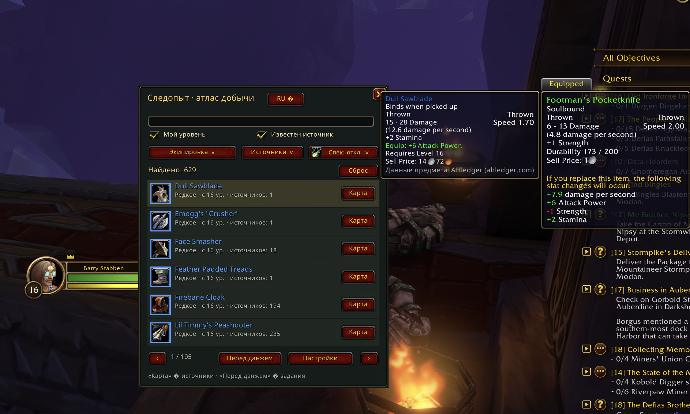
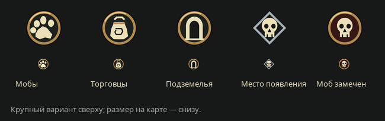

# MobAtlas · Следопыт

**Find gear, see what drops, and plan where to go next in WoW Forever.**

Look up an item, check which creatures drop it or which vendors sell it, and mark known locations on your map. Heading into a dungeon? Check the quest list before you leave.

**Beta · 0.7.9** — still growing, with bugs to fix and gaps in the database. Your feedback helps.

[**Download**](https://github.com/Simplepres/MobAtlas/releases/latest) · [Русский](#на-русском) · [Screenshots](#screenshots--скриншоты) · [Report a bug](https://github.com/Simplepres/MobAtlas/issues)

## What you can do

- Search items by name or ID, then find their known sources on the map.
- Hover over a creature to see its loot. Filter by rarity, class, level or profession materials.
- Browse groups of creatures and vendors, and pin the source you want to track — also during combat on an open map.
- Find dungeon entrances on the map. Hover for quests, click to choose one, and pin its pickup location.
- Keep a quest pinned until you remove it — even after accepting it or reloading.
- Choose Auto or a manual spec beside the atlas filters; unsuitable weapon types and known stat mismatches are filtered out.

The database is included. You don't need Questie, an account or an API key. Personal loot finds and merchant visits stay on your computer.

## Rare creatures

Get an alert when a rare is detected through an accessible nameplate, target or mouseover. See rare markers on the map and minimap; click one to inspect loot and a soft spawn-area overlay. The reference catalog covers **346 rare NPCs**.

- **Silver diamond:** a reference spawn location, not proof that the creature is alive.
- **Gold/red marker:** a detected creature with coordinates supplied by the client.
- No exact NPC coordinates? The addon keeps the reference location and labels it accordingly. It never places the NPC at your character’s position.

Toggle alerts, sound, map/minimap markers and nameplate range in **Rare creatures…** (right-click the minimap book), or `/mobatlas rares`. Detection depends on units the client exposes; it cannot scan an entire zone or promise a fixed detection radius.

Open **Rare creatures…** by right-clicking the minimap book, or type **`/mobatlas rares`**. Alerts, sound, map markers, minimap markers and soft shading can be toggled separately. The distance option requests nameplates up to **80** and enables enemy nameplates outside combat; WoW decides the actual limit. Disabling it restores the previous settings if they have not since changed.

**A spawn marker is not a live detection.** Reference spots are muted; confirmed client-supplied positions have a stronger highlight. If the client hides an NPC's coordinates, the addon says so and keeps its known spawn locations marked as reference data. It never places an NPC at the player's position. Detection depends on what the client makes available.

## Install and play

1. Download **MobAtlas-0.7.9.zip** from [Releases](https://github.com/Simplepres/MobAtlas/releases/latest).
2. Put the **MobAtlas** folder in your Forever client's `Interface/AddOns/` folder.
3. Restart WoW and enable the addon. The file should be at `Interface/AddOns/MobAtlas/MobAtlas.toc`.

Click the book by the minimap or type **`/mobatlas`**. Right-click the book for tracking options. **`/mobatlas prep`** opens dungeon preparation; **`/mobatlas settings`** opens settings.

The interface follows your game language: Russian or English, with English for other locales. Change it anytime with **Auto / RU / EN** at the top of the atlas. Item names and native tooltips come from WoW.

Leatrix Maps users keep their existing entrance and transport markers. MobAtlas adds quest details and a small quest button next to supported entrances, without a second entrance icon. Toggle this layer by right-clicking the minimap book → **Dungeons and quests**.

## Screenshots · Скриншоты

Captured November 19, 2026. / Скриншоты от 19 ноября 2026 года. Other addons and the native WoW UI may also be visible.

### Creature locations and loot · Места появления и добыча

Inspect a creature's drops and highlight its known spawn locations. **Pin** keeps the selection; **Unpin** clears it. Rates labeled Classic are reference values. / Карточка Harvest Golem: предметы, редкость, шансы и отдельные фиолетовые пятна мест появления. «Закрепить» оставляет выбор на карте; «Открепить» снимает его. Проценты Classic — справочные.

### Atlas and spec filter · Атлас и подбор под спек

Search gear, compare item tooltips and open known sources on the map. The spec control is beside the item filters: **Off**, **Auto**, or a manual talent tree. It is off in this screenshot. / Поиск вещей, сравнение характеристик с надетым предметом и переход к источникам на карте. Спек выбирается рядом с фильтрами: «Откл.», «Авто» или вручную. На скриншоте фильтр спека выключен; иконки веток обновлены после съёмки.

### Dungeon preparation · Задания перед данжем

The Stockade quest list shows prerequisite chains and required levels. Available steps open a pickup marker; future quests stay visible with their level requirement. / Задания для Тюрьмы: видно, где сначала нужна цепочка и с какого уровня доступен квест. Доступный шаг можно открыть на карте; будущие задания остаются в списке с указанием уровня. Внизу — свободное место в сумках и состояние ремонта.

## На русском

**Следопыт помогает понять, где достать нужную вещь в WoW Forever.** Найди её в атласе, посмотри мобов или торговцев и выдели известные места на карте. Добычу можно смотреть прямо при наведении на моба, а перед данжем — проверить задания и первые шаги цепочек.

На карте отмечены известные входы в подземелья. Наведи на вход, чтобы увидеть задания, и нажми, чтобы выбрать квест. Его точка останется закреплённой до клика по метке, повторного выбора или кнопки «Открепить» — даже после принятия задания и `/reload`. С Leatrix Maps сохраняются его значки и транспорт, а рядом со входом появляется маленькая кнопка заданий.

Спек выбирается прямо в атласе: «Авто» по талантам или вручную. Фильтр учитывает доступное классу оружие, требования выбранной ветки и известные основные характеристики; это подбор подходящих вещей, а не гарантия BiS. Есть фильтры по редкости, классу, уровню и материалам профессий. База уже внутри: отдельно ставить Questie не нужно.

**Как установить:** скачай [MobAtlas-0.7.9.zip](https://github.com/Simplepres/MobAtlas/releases/latest), положи папку `MobAtlas` в `Interface/AddOns/` клиента Forever и перезапусти WoW.

Карта работает и в бою: можно смотреть добычу, выбирать и закреплять источники. Если WoW блокирует открытие карты из аддона, открой её клавишей **M**.

**Как открыть:** книжка у миникарты или `/mobatlas`. `/mobatlas prep` — задания перед данжем, `/mobatlas settings` — настройки. Язык выбирается по клиенту; кнопка **Auto / RU / EN** меняет его вручную и сохраняет выбор.

**Редкие мобы:** серебристый ромб отмечает справочное место появления. Золотисто-красный значок появляется для обнаруженного моба, когда клиент сообщает его координаты. Есть уведомления при обнаружении, метки на карте и миникарте, мягкая область появления после выбора моба. Настройки: ПКМ по книжке → **«Редкие мобы…»** или `/mobatlas rares`. Опция дальности запрашивает до 80 и включает имена врагов вне боя; фактический предел задаёт WoW. Выключение опции восстанавливает прежние значения, если они не менялись. Точка из базы не означает, что моб сейчас жив; неизвестные координаты не заменяются позицией игрока.

**Это бета.** База ещё пополняется, часть координат и условий заданий неизвестна. Метки показывают известные места появления, а не живых мобов. Проценты из Classic отмечены отдельно от наблюдений Forever. Личные находки никуда не отправляются.

## Feedback · Обратная связь

Found a bug or have an idea? / Нашёл баг или хочешь что-то предложить?

Write directly: [**Telegram @brunotwin**](https://t.me/brunotwin) · [**Threads @teur_person**](https://www.threads.com/@teur_person), or open an [issue](https://github.com/Simplepres/MobAtlas/issues). A screenshot, item or creature name, and a short description of what happened are helpful.

## Data and credits

Hover tooltips show the top few matching items; the count tells you how much more is available in the map card. New Forever creatures are included, but many still have incomplete loot tables. Direct loot observations fill gaps locally; they are not uploaded.

Locations and loot tables are reference data, not a live radar or a complete record of every Forever drop. Classic rates and Forever observations are labeled separately. Some sources, entrances and quest requirements are still missing.

Thanks to QuestieDB/Questie, Everloot, WoW Forever KB and the Classic reference contributors. Item metadata from [AHledger](https://ahledger.com); font: Noto Sans.

[Data, privacy and upstream notices](docs/DATA-AND-CREDITS.md) · [License scope](LICENSE.md) · [Source details](MobAtlas/SOURCES.md) · [Development](docs/DEVELOPING.md)

Independent community addon, not affiliated with Blizzard Entertainment. Third-party data and assets retain their own terms.

### Map icons · 0.7.9

Original, compact map markers. Rare spawn references stay anchored to fixed locations on the minimap. Only confirmed live positions can follow a moving creature.

