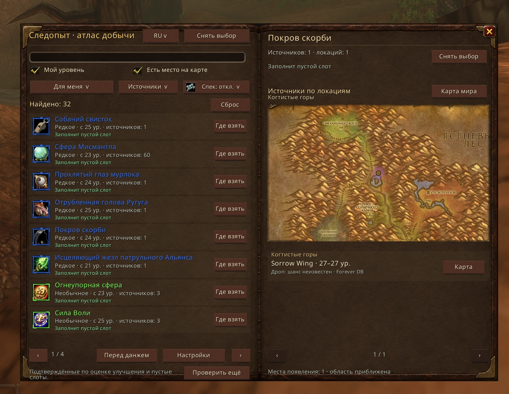
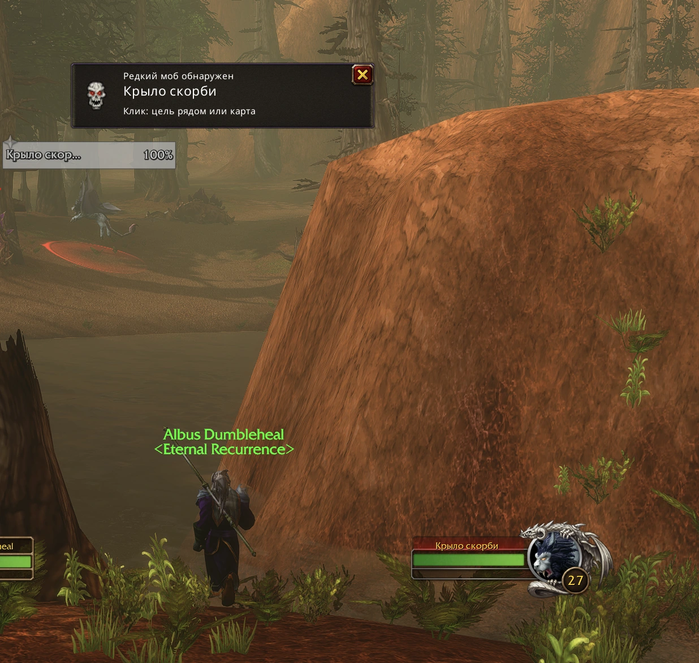
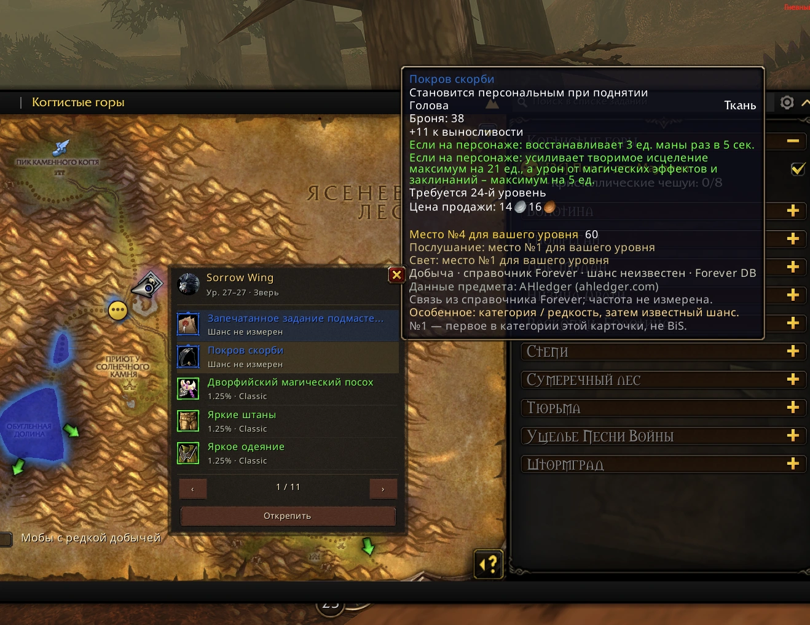
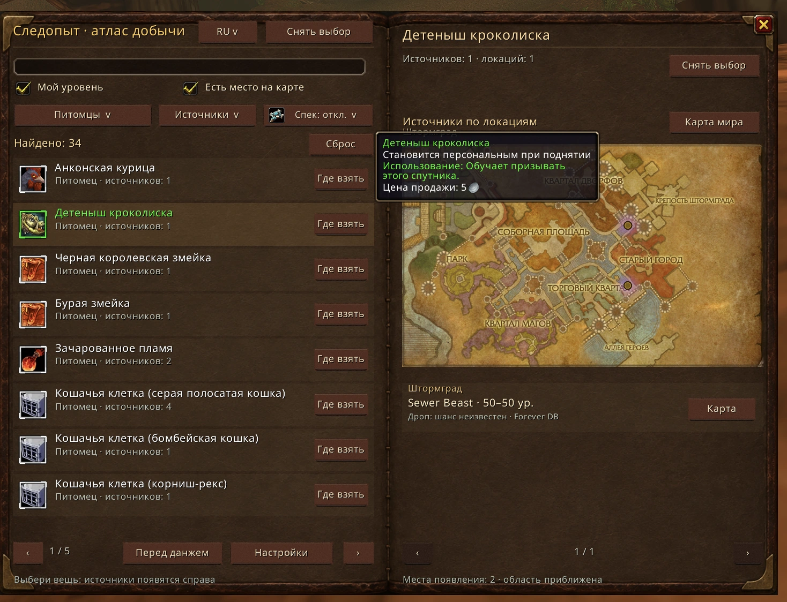
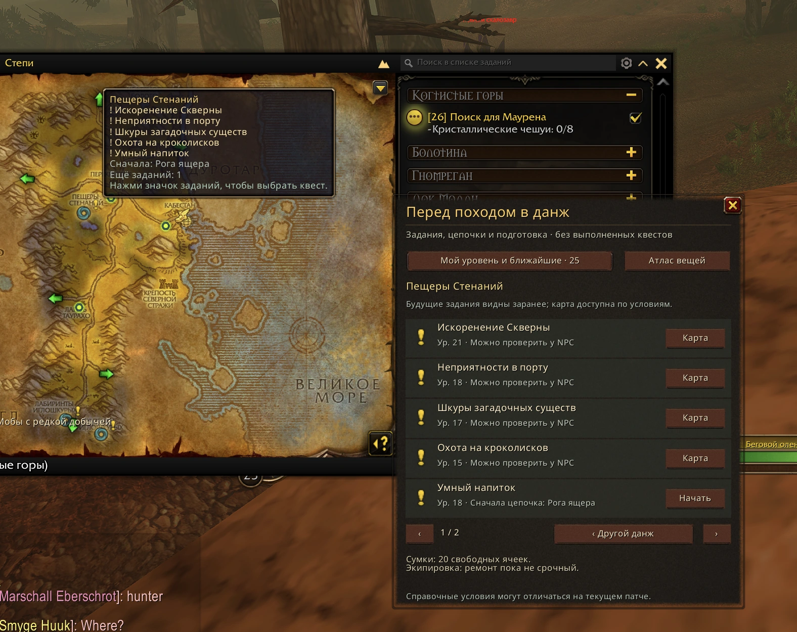
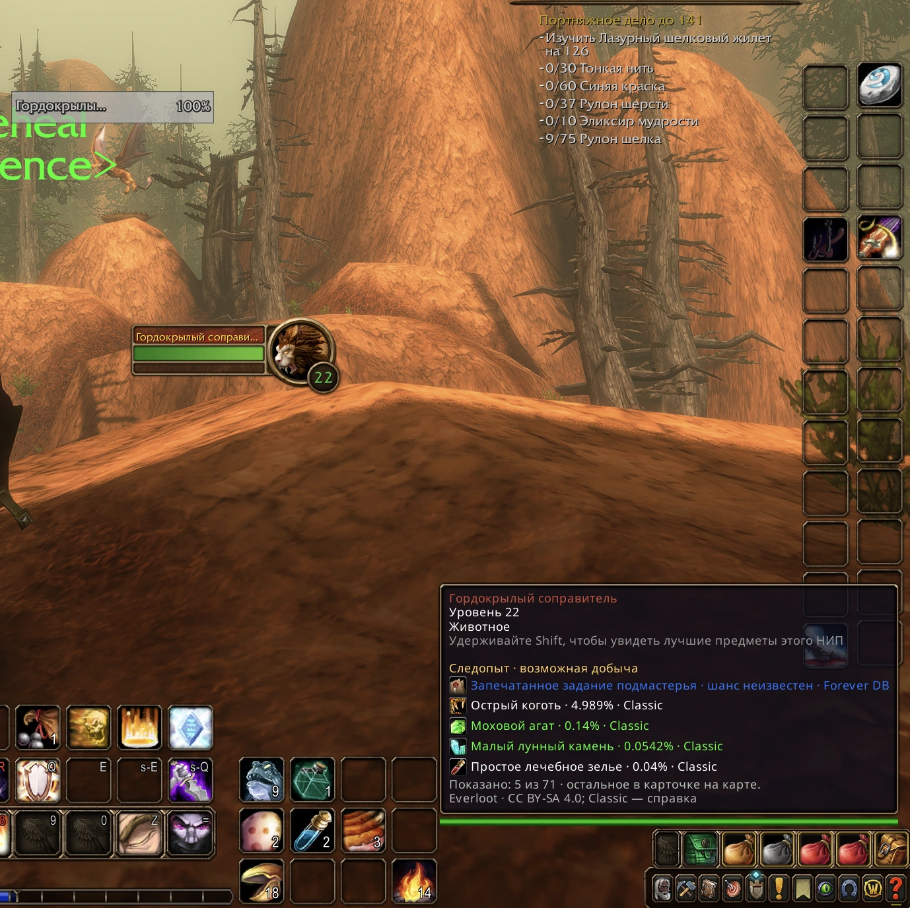

# MobAtlas · Следопыт

Атлас добычи, экипировки и заданий для **WoW Forever**. **Бета 0.7.11.**

A loot atlas, gear finder and dungeon quest guide for **WoW Forever**. **Beta 0.7.11.**

[**Скачать / Download**](https://github.com/Simplepres/MobAtlas/releases/latest) · [Скриншоты / Gallery](#скриншоты--gallery) · [Сообщить о баге / Report an issue](https://github.com/Simplepres/MobAtlas/issues)

## Что нового в 0.7.11

- **Атлас в виде книги.** Восемь предметов слева, источники и мини-карта справа. «Карта» сразу ставит метку на карте мира.
- **Подбор экипировки.** Сравнение с надетыми вещами, фильтры по уровню, классу и спеку, отдельный выбор ткани, кожи, кольчуги, лат и оружия.
- **Редкие мобы.** Клик по уведомлению берёт обнаруженного моба в цель вне боя, если он ещё доступен, или показывает известное место на карте. Галочка «Мобы с редкой добычей» оставляет источники синих вещей и выше или питомцев. «Запечатанное задание подмастерья» не учитывается этим фильтром.

**Уже в аддоне:** поиск по названию и ID, добыча при наведении, торговцы с известными ценами, питомцы, входы в подземелья и задания с цепочками. Источники, мобы и точки начала квестов можно закреплять. База поставляется вместе с аддоном.

## What’s new in 0.7.11

- **Two-page atlas.** Eight items on the left, a source list and map preview on the right. **Map** opens the world map with the selected source pinned.
- **Gear finder.** Compare with equipped gear, filter by level, class and spec, or browse cloth, leather, mail, plate and weapons.
- **Rare tracking.** Click an alert to target a detected rare out of combat, or open its known location on the map. A map checkbox shows mobs that drop blue-quality items or better, or pets. Sealed Journeyman's Writ is excluded from this filter.

Also includes item search, loot on hover, vendors with known prices, pet sources, dungeon entrances, quests and prerequisites. The reference database is bundled.

## Установка / Install

Распакуй **MobAtlas-0.7.11.zip** в `Interface/AddOns/` клиента Forever и полностью перезапусти WoW. Открой атлас через книжку у миникарты или `/mobatlas`. ПКМ по книжке открывает настройки отслеживания.

Extract **MobAtlas-0.7.11.zip** into the Forever client’s `Interface/AddOns/` folder and restart WoW. Click the minimap book or type `/mobatlas`. Right-click the book for tracking settings.

## Скриншоты / Gallery

**Атлас экипировки / Gear atlas**

Рекомендации слева, карта источника справа. / Gear suggestions on the left, source map on the right.

**Обнаружение редких мобов / Rare discovery**

Следопыт заметил Крыло скорби. Клик по уведомлению берёт моба в цель вне боя, если он ещё доступен, или открывает карту с известным местом появления.

MobAtlas spotted Sorrow Wing. Click the alert to target it out of combat if it is still available, or open its known spawn location on the map.

Ещё скриншоты / More screenshots

**Закреплённый редкий моб / Pinned rare**

Карточка добычи Sorrow Wing и его метка в Когтистых горах. / Sorrow Wing’s loot card and map marker in Stonetalon Mountains.

**Питомцы / Pets**

Где искать детёныша кроколиска в Штормграде. / Where to look for the crocolisk pet in Stormwind.

**Перед данжем / Dungeon prep**

Задания и цепочки для Пещер Стенаний. / Wailing Caverns quests and prerequisites.

**Добыча при наведении / Loot on hover**

Известные предметы прямо в подсказке моба. / Known drops in the creature tooltip.

Метки показывают известные места появления. Обнаружение живых мобов зависит от данных клиента. Проценты Classic подписаны отдельно, а неизвестные шансы и цены отмечены в интерфейсе.

Spawn markers show known locations. Live detection depends on what the game client exposes. Classic rates are labeled and unknown prices or chances are marked in the UI.

[Источники и авторы / Data and credits](docs/DATA-AND-CREDITS.md) · [Лицензии / Licenses](LICENSE.md) · [Telegram @brunotwin](https://t.me/brunotwin) · [Threads @teur_person](https://www.threads.com/@teur_person)
